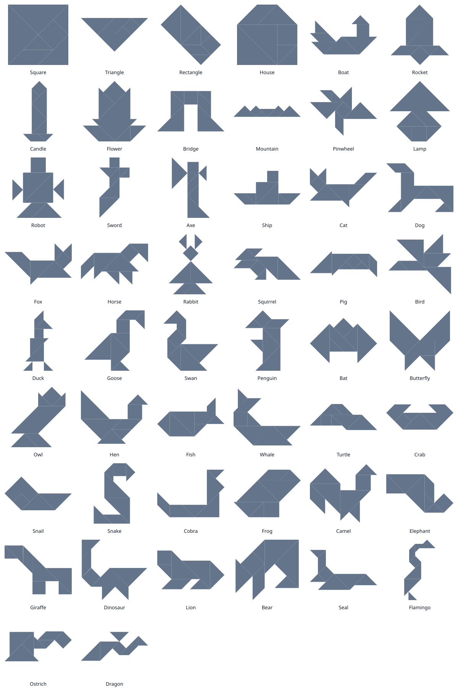

# 七巧板 · Tangram

一个单文件的七巧板游戏，零依赖、零构建步骤。

A single-file tangram game — no dependencies, no build step.



## 运行 · Run

直接用浏览器打开 `index.html`：

```sh
open index.html
```

## 玩法 · How to play

- **自由模式 Free Play** — 拖动七块拼板自由拼搭。
- **关卡模式 Puzzle** — 在灰色轮廓中拼出目标图形，拼对即通关。
- 拖动拼板；点击选中后用 **R** 旋转 45°、**F** 翻转（也可用工具栏按钮）。
- 关卡模式下松手会自动吸附到轮廓上，便于对齐。
- **Next ▶ / ◀ Prev** 切换关卡（也可用键盘 `N`/`P` 或方向键 ←/→），到末尾会循环。
- **Guides**（默认开）在轮廓里画出每块拼板的接缝，一眼就能看出该怎么拼；
  **Solve** 一键演示正确拼法。
- **Demo** 用七块彩色拼板填满轮廓，显示完成的七巧板大图，适合展示；再点一次
  即可回到游戏。页面打开时默认就是第一个关卡（Square）的 Demo 视图。

Features:

- Drag pieces with mouse or touch.
- `R` rotates the selected piece by 45°; `F` flips it (needed for the
  parallelogram).
- Puzzle mode draws the target silhouette and magnetically snaps pieces into
  place.
- **Next ▶ / ◀ Prev** move between levels (`N` / `P` or ← / → also work) and
  wrap around.
- **Guides** (on by default) draws the seams between the seven pieces inside the
  outline, so you can see how they fit; **Solve** demonstrates the solution.
- **Demo** fills the outline with the seven coloured pieces to show the completed
  tangram at full size; click it again to go back to playing. The page opens in
  Demo view on the first level (Square).
- Win detection matches position **and** shape, so identical pieces
  (two large / two small triangles) are interchangeable.

## 关卡 · Levels

内置 **50 个关卡**：

- 经典：**Square**、**Triangle**、**Rectangle**；
- 动物：Cat、Dog、Fox、Horse、Rabbit、Squirrel、Pig、Bird、Duck、Goose、
  Swan、Penguin、Bat、Butterfly、Owl、Hen、Fish、Whale、Turtle、Crab、Snail、
  Snake、Cobra、Frog、Camel、Elephant、Giraffe、Dinosaur、Lion、Bear、Seal、
  Flamingo、Ostrich、Dragon；
- 物件 / 人物：House、Boat、Rocket、Candle、Flower、Bridge、Mountain、
  Pinwheel、Lamp、Robot、Sword、Axe、Ship。

轮廓取自 KiloGram 数据集（详见 [`tools/README.md`](tools/README.md) 与其中的出处 /
许可说明）。`preview.svg` 是所有轮廓的总览图。

## 几何 · Geometry

采用标准七巧板单位（小三角形直角边 = 1）：

| 名称 | 类型 | 顶点 |
| --- | --- | --- |
| 小三角形 ×2 | `S` | `(0,0) (1,0) (0,1)` |
| 中三角形 ×1 | `M` | `(0,0) (2,0) (1,1)` |
| 大三角形 ×2 | `L` | `(0,0) (2,0) (0,2)` |
| 正方形 ×1   | `Q` | `(0,0) (1,0) (1,1) (0,1)` |
| 平行四边形 ×1 | `P` | `(0,0) (1,0) (2,1) (1,1)` |

每块可旋转 45° 的整数倍（8 个朝向），平行四边形额外允许镜像。
坐标用浮点数表示（含 `√2`），判断「拼对」时使用较小的容差。

## 结构 · Layout

```
index.html               # 整个游戏（含内嵌关卡数据）
preview.svg              # 所有关卡轮廓总览
tools/build_puzzles.py   # 从 KiloGram 生成关卡数据
tools/solve.py           # 轮廓求解器（用于三个经典关卡）
tools/make_preview.py    # 生成 preview.svg
tools/puzzles.json       # 生成的关卡数据（注入 index.html）
tools/README.md          # 数据来源 / 许可 / 用法
```

### 重新生成关卡 · Rebuild levels

```sh
cd tools
python3 build_puzzles.py --inject   # 需要联网下载 KiloGram 的 SVG
```
